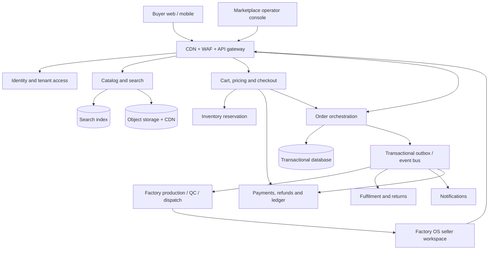
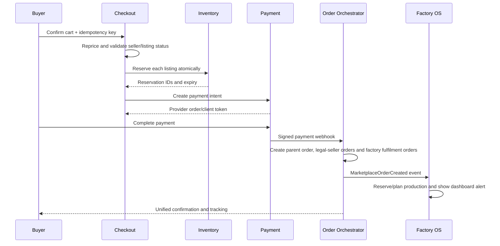

# Factory OS Marketplace — Product Report and System Design

Generated: 20 October 2026  
Status: Proposed architecture for implementation  
Product model: Multi-tenant Factory OS + multi-seller B2B/B2C marketplace

## 1. Executive summary

Factory OS should become one connected platform with two experiences:

1. **Factory workspace:** a factory owner registers, completes verification, configures the plant, publishes products, manages inventory, receives marketplace orders, manufactures or picks the goods, dispatches them, handles returns, and receives settlements.
2. **Buyer marketplace:** a customer registers, searches products from many factories, adds products to a cart, pays, tracks shipments, raises returns or RFQs, and communicates with the responsible factory without learning the factory's private BOM, cost, payroll, or operational data.

The central design rule is: **one buyer checkout creates one parent order; commercial liability is split by legal seller/GST registration; fulfilment is then split by factory and seller location.** Every factory receives only its fulfilment allocation in Factory OS. Invoice, commission and settlement remain attached to the legal seller, not an individual plant.

This follows the useful marketplace concepts documented by Flipkart: product and listing are separate concepts; a customer order may contain products from multiple sellers; fulfilment is operated at shipment level; sellers manage listings, stock, price, SLA, orders and settlements. Factory OS should adopt those concepts without copying Flipkart's UI or proprietary implementation.

## 2. Verified marketplace lessons

### Seller onboarding

Flipkart's public seller journey is: register with business and bank details, list at least one product, receive orders, ship, then receive payment. A valid GSTIN is normally part of onboarding. For Factory OS, onboarding should therefore be a state machine rather than a single registration form:

`account_created → email_or_phone_verified → business_profile → GST/KYC_review → bank_verified → factory_configured → approved → active`

Source: [Flipkart Seller registration journey](https://seller.flipkart.com/?no_redirect=true)

### Product versus listing

A **product** is normalized marketplace content: title, category, attributes, specifications and media. A **listing** is a seller's commercial offer for that product: seller SKU, factory, location, price slabs, stock, MOQ, dispatch SLA and status. Multiple factories may sell the same normalized product using different listings.

Source: [Flipkart Marketplace Seller API overview](https://seller.flipkart.com/api-docs/FMPlatOverview.html)

### Order and shipment model

A buyer order can contain products from different sellers. It is split into a SellerOrder for each legal seller/GST registration, then into FulfilmentOrders for the responsible factories/locations and finally into shipments. Shipment is the operational unit for pick, pack, dispatch, tracking and delivery; commercial invoices remain tied to the SellerOrder. Factory OS already has manufacturing work orders and dispatch concepts, so marketplace fulfilment allocations should feed those workflows rather than create a separate operational silo.

Source: [Flipkart Marketplace order model](https://seller.flipkart.com/api-docs/FMPlatOverview.html)

### Fulfilment options

The platform should eventually support:

- **Factory fulfilled:** factory packs and ships using its own courier.
- **Platform logistics:** platform allocates a logistics partner and pickup.
- **Platform fulfilment:** future warehouse/storage service.

Flipkart similarly exposes platform fulfilment and seller-premise fulfilment models.

Source: [Flipkart fulfilment overview](https://seller.flipkart.com/sell-online?login=true)

### Settlement is not the same as payment capture

Buyer payment should enter a platform-controlled ledger. Seller payable is created only after fulfilment events and adjusted for commission, shipping, taxes, refunds, returns and penalties. The settlement ledger must remain auditable at order-item level.

Sources: [Flipkart fees and payment cycle](https://seller.flipkart.com/fees-and-commission), [Flipkart Seller API concepts](https://seller.flipkart.com/api-docs/FMPlatOverview.html)

### REA observation

A controlled, logged-out inspection of the Flipkart web storefront showed a separately delivered web shell, lazy-loaded page modules, dedicated API origins, CDN media delivery, analytics/telemetry, and mobile app assets. This supports using independently deployable buyer, seller, and operator surfaces over shared APIs. The observation was limited to the public homepage; it did not inspect authenticated or private seller behavior.

## 3. Target users and surfaces

| Surface | Primary users | Responsibilities |
|---|---|---|
| Buyer Marketplace | Retail buyers, dealers, procurement teams | Search, compare, cart, checkout, RFQ, tracking, returns, reviews |
| Factory OS | Owner, plant manager, supervisor, accountant | Listings, inventory, marketplace orders, production, QC, dispatch, invoices |
| Seller Onboarding | Factory owner and authorized staff | Business verification, GST/KYC, bank, pickup locations, agreements |
| Operator Console | Marketplace operations, finance, support, risk | Seller approval, catalog moderation, disputes, commissions, settlements, audit |
| Logistics Portal/API | Courier/platform logistics | Pickup, labels, scan events, tracking, delivery, reverse pickup |

## 4. Core user journeys

### Factory owner

1. Create account using email/mobile OTP.
2. Create or claim a factory organization.
3. Submit legal name, business type, GSTIN/PAN, registered address, pickup locations, bank account and authorized representative details.
4. Accept seller agreement and marketplace policies.
5. Operator or automated checks approve the seller.
6. Link Factory OS internal products to public marketplace products.
7. Create listings with buyer-safe content, MOQ, unit, GST, price slabs, lead time and available stock.
8. Receive the factory's marketplace FulfilmentOrders in the existing Orders dashboard.
9. Convert made-to-order items into production/work orders; reserve stock for ready inventory.
10. Perform QC, pack, invoice and dispatch.
11. Track delivery, returns, fees and settlements.

### Buyer

1. Browse without signing in; sign in for cart/checkout.
2. Search and filter products by category, location, MOQ, lead time, price and verified seller.
3. View product information and listing-specific offer data.
4. Add offers from one or more factories to one cart.
5. Select delivery address, GST invoice details, payment option and fulfilment method.
6. Platform revalidates price and stock server-side.
7. Payment is authorized/captured and one parent order is created.
8. Parent Order is split into legal-seller SellerOrders, factory/location FulfilmentOrders and Shipments.
9. Buyer sees unified tracking; each factory sees only its assigned order.
10. Buyer can request cancellation, return, replacement, refund or support according to policy.

### B2B RFQ

For custom manufacturing or large quantities, the buyer creates an RFQ instead of immediate checkout. Selected factories submit quotes. The accepted quote is converted into a contract/order with milestones, advance payment, specifications and attachments.

## 5. Recommended architecture

### Deployment recommendation

Start as a **modular monolith with clear service boundaries**, not many microservices. Current traffic and team size do not justify distributed operational overhead. Deploy separate frontend applications, but keep business modules in one backend codebase with transactional consistency and an outbox. Extract services only when scale or ownership proves the need.

- `marketplace-web`: public buyer storefront.
- `factory-os-web`: existing factory operations application.
- `operator-web`: marketplace operations console.
- `commerce-api`: authenticated business API / Firebase Functions initially.
- **PostgreSQL is the system of record for checkout, orders, inventory reservations, payment state, ledger, returns and settlements before real-money checkout launches.** Order writes, ledger writes and outbox events commit in one PostgreSQL transaction. Firestore remains the read-optimized Factory OS projection and collaboration store; it is never dual-written as a second financial authority.
- Algolia, Typesense, Meilisearch, Elasticsearch or OpenSearch for discovery; do not use Firestore scans as a search engine.
- Cloud Storage with CDN for product media.
- Razorpay or another Indian payment provider with verified webhooks and reconciliation jobs.
- Transactional outbox or Cloud Tasks/Pub/Sub for reliable asynchronous work.

## 6. Domain model

### Identity and organizations

- `users`
- `organizations`
- `organization_memberships`
- `factories`
- `seller_applications`
- `seller_documents`
- `seller_bank_accounts`
- `seller_locations`
- `role_assignments`

### Catalog

- `categories`
- `attribute_definitions`
- `products` — normalized buyer-facing product
- `product_variants`
- `listings` — factory offer for a product/variant
- `listing_prices`
- `listing_inventory`
- `listing_media`
- `listing_approvals`

### Commerce

- `carts`, `cart_items`
- `checkout_sessions`
- `orders` — buyer-facing parent order
- `seller_orders` — one per legal seller/tax registration
- `order_items`
- `inventory_reservations`
- `fulfilment_orders` — factory/location allocation under a seller order
- `shipments`, `shipment_items`, `tracking_events`
- `cancellations`, `returns`, `return_items`

### Money

- `payment_intents`, `payment_attempts`, `refunds`
- `ledger_accounts`, `ledger_entries`
- `fee_rules`, `commission_rules`
- `seller_payables`, `settlements`, `settlement_lines`
- `invoices`, `credit_notes`, `tax_documents`

### Communication and governance

- `notifications`, `support_tickets`, `disputes`
- `reviews`, `moderation_cases`
- `audit_events`, `webhook_inbox`, `outbox_events`

## 7. Order orchestration

### Invariants

- Prices, taxes, stock and seller eligibility are recalculated server-side.
- All mutating commands carry idempotency keys.
- A listing cannot expose internal BOM, costs, vendors or private stock strategy.
- Inventory reservation has an expiry and compensating release.
- Payment webhooks are signature-verified, stored in an inbox and processed once.
- `payment.failed` cannot downgrade an already paid/refunded order.
- Parent Order status is derived from SellerOrders and FulfilmentOrders; a seller cannot see another seller's data, and a factory sees only its own fulfilment allocation.
- Ledger entries are append-only; balances are derived, not overwritten.
- Settlement happens only from eligible delivered order items after the return-risk policy window.

## 8. Factory OS integration

The repository already contains useful foundations:

- Factory-scoped catalog listing UI.
- Public catalog projection.
- Order, payment, refund and webhook Functions.
- Firestore role and tenant rules.
- Inventory, work orders, QC, dispatch, billing and accounting screens.

Required integration:

1. Replace environment-level `VITE_FACTORY_ID` with authenticated organization/factory membership.
2. Create seller onboarding and approval workflows.
3. Add a separate buyer storefront application.
4. Introduce parent order, legal-seller order, factory fulfilment order and shipment models.
5. Project each factory fulfilment order into the correct Factory OS dashboard via an outbox event.
6. Convert order items to stock allocation or manufacturing work orders based on product policy.
7. Connect QC and dispatch completion back to marketplace shipment states.
8. Replace demo/localStorage business records with durable tenant-scoped storage.
9. Add operator moderation, risk, settlement and support surfaces.

## 9. Security and compliance

- Firebase Auth or equivalent for identity; custom claims only for coarse roles, database membership for live authorization.
- MFA for factory owners, finance users and operator admins.
- GSTIN/PAN/bank verification through approved providers; encrypt sensitive fields.
- No bank account or KYC documents in browser-readable documents.
- Per-factory access checks on every seller operation.
- WAF, rate limits, bot controls and abuse monitoring on signup, search, cart and checkout.
- PCI scope minimized through hosted/tokenized payment UI.
- DPDP Act-aligned consent, purpose limitation, retention and deletion workflows.
- Immutable audit trail for onboarding, listing approval, order state, refunds and settlements.
- Scoped operator roles such as seller-reviewer, catalog-moderator, support-agent, finance-operator and risk-admin; never rely on one global admin claim.
- Maker-checker approval for seller bank changes, manual refunds, commission changes and settlement release. Record immutable before/after values, actor, approver, reason and correlation ID.
- Time-bound, separately audited emergency access with post-event review.
- Signed URLs, content-type validation, malware scanning and image processing for uploads.
- Secret Manager for provider credentials; separate test and production projects.

## 10. Zapier-style automation layer

Zapier should be an optional integration surface, never the source of truth for orders or money.

### Outbound triggers

- Seller approved
- Listing approved/rejected
- New seller order
- Order SLA at risk
- Shipment dispatched/delivered
- Return opened
- Settlement completed

### Actions

- Create/update lead in CRM
- Send WhatsApp/email/SMS through approved providers
- Create shipping pickup
- Add support ticket
- Append an analytics row

Every automation delivery needs a signed payload, event ID, retries with backoff, dead-letter handling and an audit log. Payment capture, inventory reservation, refunds and settlement must stay inside the core platform.

## 11. MVP scope

### Include

- Buyer and factory-owner registration.
- Manual operator approval for sellers.
- One factory organization per owner initially, multiple locations supported in schema.
- Public browse/search/category/product/listing pages.
- Single- and multi-factory cart.
- Prepaid checkout; COD later.
- Parent Order split into SellerOrders per legal seller/GST registration, then FulfilmentOrders per factory/location.
- Factory dashboard new-order inbox and status actions.
- Factory-fulfilled shipping with manual courier/AWB.
- Buyer order tracking.
- Basic cancellation/refund.
- Platform commission configuration and simple seller payable report.
- Email/in-app notifications.

### Defer

- Platform warehouses.
- Automated lending/credit.
- Dynamic ads bidding.
- International selling.
- Complex seller tiering.
- Automated dispute arbitration.
- Native mobile applications.

## 12. Delivery blueprint

| Phase | Deliverable | Dependency | Exit criteria |
|---|---|---|---|
| 0 | Legal/financial ADRs, data authority, auth, payment reconciliation and CI | None | MoR, invoice issuer, GST/TCS/TDS, funds flow, refund liability and settlement policy approved; PostgreSQL authority and migration plan approved; production config and payment/rules tests green |
| 1 | Organization + seller onboarding | Phase 0 | Approved seller can enter Factory OS securely |
| 2 | Canonical catalog + listing approval | Phase 1 | Approved listing appears in public catalog |
| 3 | Buyer storefront + search + cart | Phase 2 | Buyer can build multi-factory cart |
| 4 | Checkout + legal-seller split + factory fulfilment split + inventory | Phase 3 | Paid checkout creates correct seller and fulfilment orders once in PostgreSQL |
| 5 | Factory dashboard integration | Phase 4 | Seller sees and processes only its own order |
| 6 | Shipment, tracking, cancellation and returns | Phase 5 | Complete forward and reverse lifecycle works |
| 7 | Ledger, commission and settlement | Phases 4, 5 and 6 | Shadow ledger reconciles first; real settlement releases only after delivery and configured return-risk window |
| 8 | Operator console + support + automation | Phases 1–7 | Ops can approve, monitor and resolve exceptions |
| 9 | Security, load, disaster-recovery and launch gates | All | Go-live checklist signed off |

Parallel work: buyer design can start during catalog implementation; operator UI can start after onboarding contracts stabilize. A non-paying shadow ledger may run alongside fulfilment, but real seller settlement cannot launch until delivery and reverse-commerce events are authoritative.

### Versioned migration from the existing order model

The current single-factory `/orders` documents and Functions must not be silently reinterpreted as multi-seller parent orders.

1. Freeze and document the v1 single-factory contract.
2. Add PostgreSQL `orders`, `seller_orders`, `fulfilment_orders` and ledger tables as v2.
3. Publish explicit buyer, seller and factory projections to separate Firestore namespaces; sellers never receive the parent-order document.
4. Add v2 APIs and deny legacy writers from creating marketplace orders after the cutover flag.
5. Dual-read only for controlled UI transition; never dual-write financial state.
6. Backfill historical v1 orders as read-only legacy records with reconciliation totals.
7. Run shadow comparison, then route new checkout traffic to v2 by a reversible feature flag.
8. Rollback disables new v2 checkout but preserves already-created v2 orders in their authoritative workflow.

## 13. Success metrics

- Seller registration-to-approval conversion.
- Approval-to-first-live-listing time.
- Search-to-product-view and product-view-to-cart conversion.
- Checkout success rate.
- Inventory reservation conflicts and oversell rate.
- Order acknowledgement and dispatch SLA compliance.
- Cancellation, return and refund rate.
- Settlement accuracy and dispute rate.
- Marketplace GMV, take rate and repeat purchase rate.
- Factory OS weekly active sellers.

## 14. Phase-0 blocking decisions

Real-money checkout and seller settlement must remain disabled until signed ADRs establish:

1. Marketplace B2B/B2C focus, contracting parties and Merchant of Record.
2. GST invoice/credit-note issuer, tax collection/withholding responsibilities and professional tax validation.
3. Payment collection account, refund liability, chargeback liability and seller funds flow.
4. Commission, shipping, return-window and settlement-release rules.
5. PostgreSQL ownership of order, ledger and outbox transactions plus cutover/rollback.
6. Initial categories and prohibited/restricted goods policy.
7. Factory-fulfilled-only launch or contracted logistics partner.
8. KYC/GST/bank verification providers and data-processing agreements.

## Sources

1. [Flipkart Seller registration journey](https://seller.flipkart.com/?no_redirect=true)
2. [Flipkart selling, fulfilment and payment overview](https://seller.flipkart.com/sell-online?login=true)
3. [Flipkart fees and commission](https://seller.flipkart.com/fees-and-commission)
4. [Flipkart Marketplace Seller API overview](https://seller.flipkart.com/api-docs/FMPlatOverview.html)
5. [Flipkart Marketplace API documentation](https://seller.flipkart.com/api-docs/index.html)
6. [Flipkart Commerce Cloud Seller Management overview](https://docs.flipkartcommercecloud.com/docs/digital-commerce/seller-management/docs/overview)
7. [Flipkart Commerce Cloud Catalog overview](https://docs.flipkartcommercecloud.com/docs/digital-commerce/catalog/docs/overview)

### Research limitations

Public documentation describes product concepts and external behavior, not Flipkart's complete private architecture. Architecture recommendations in this document are therefore informed design choices for Factory OS, not claims about Flipkart's internal source code.
